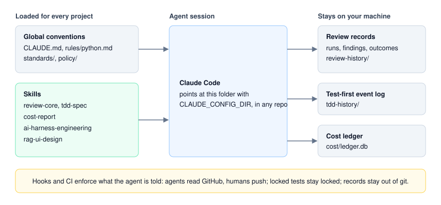

<h1 align="center">ClaudeConfig</h1>

<p align="center">
  <b>A version-controlled Claude Code setup for serious solo engineering.</b><br>
  Global conventions, evidence-backed code review, locked test-first development, cost tracking and
  a read-only GitHub policy for agents, kept in one portable <code>CLAUDE_CONFIG_DIR</code>.
</p>

<p align="center">
  
  
  
  
  <a href="LICENSE"></a>
</p>

---

## Why ClaudeConfig

A coding agent writes code quickly and reports success confidently. On a one-person project there
is no second engineer to catch what it got wrong, so the checks have to live somewhere the agent
can't talk its way past.

This repo holds those checks, built while using agents on four projects:
[faultline](https://github.com/YadavSanjay/faultline),
[XbrlRag](https://github.com/YadavSanjay/XbrlRag),
[MacroRAG](https://github.com/YadavSanjay/MacroRag) and
[RagInference](https://github.com/YadavSanjay/RagInference).

- **The one who writes isn't the one who judges.** Reviews run in a fresh context from a
  script-built packet, and a refuter tries to disprove every serious finding.
- **Tests are written first and locked.** Implementing agents can't pass by editing the tests.
- **Rules that matter are enforced, not requested.** Hooks and GitHub permissions hold whatever the
  agent decides to do.
- **Numbers come from scripts.** Token counts, costs and blast radius are computed, never estimated
  by the model.

<p align="center">
  
</p>

## What's inside

| Path | Contents |
|---|---|
| [CLAUDE.md](CLAUDE.md) | Cross-project conventions: environment, quality gate, secrets, git, working style |
| [rules/python.md](rules/python.md) | Python standard, loaded when an agent works on `.py` files |
| [standards/](standards/design/plan.md) | Design of the shared coding standard |
| [skills/](skills/) | The skills below, with their tests and design notes |
| [docs/guides/](docs/guides/) | Plain-language guides to the skills |
| [policy/](policy/DESIGN.md) | Read-only GitHub access for agents, with a script that proves it |
| [settings.example.json](settings.example.json) | Hooks and status line to copy and fill in |

## The skills

| Skill | What it does | Guide |
|---|---|---|
| [review-core](skills/review-core/SKILL.md) | Evidence-backed review: P0–P3 severity, PROVEN/TRACED/INFERRED evidence, measured blast radius and a ledger of what was checked | [guide](docs/guides/review-core.md) |
| [tdd-spec](skills/tdd-spec/SKILL.md) | Spec tests are written from a spec, proven red, locked and merged before implementation | [guide](docs/guides/tdd-spec.md) |
| [cost-report](skills/cost-report/SKILL.md) | Tokens, API-equivalent cost and plan limits per session, subagent and skill, from a local ledger | [guide](docs/guides/cost-report.md) |
| [ai-harness-engineering](skills/ai-harness-engineering/SKILL.md) | Audits a project's agent setup against a dated standard and plans the fixes | [guide](docs/guides/ai-harness-engineering.md) |
| [rag-ui-design](skills/rag-ui-design/SKILL.md) | Redesigns the interface of a RAG or AI-search product | |

### review-core

Run it as `/review-core [quick|standard|deep] [target]`. It complements the built-in `/code-review`.

- **Findings** carry a severity, an evidence tier instead of a confidence percentage, and a blast
  radius measured from a transitive caller tree. Every report ends with what was read, run and
  skipped. The scales are in [contract.md](skills/review-core/contract.md).
- **Effort** runs from an inline pass to consumer-impact reviewers, base-versus-change test runs
  and a red team that leaves proof tests behind.
- **Project packs** let a repo add a profile, domain lenses, suppressions and a code map under
  `.claude/review/`.
- **It's advisory.** It never edits the reviewed repo, and the AI never approves a PR.
- **Records** feed per-lens precision and a monthly retro, so a lens can earn the right to block
  merges later. See [the design](skills/review-core/design/outcomes-and-retro.md).

### tdd-spec

Your branch sets your role: `spec/<id>` writes tests and stubs, `impl/<id>` writes the code. The
gate proves the tests red for the right reason, locks them by hash, and refuses changes to them
during implementation. Disputes go to a human instead of into an edit. The threat model is in
[design/plan.md](skills/tdd-spec/design/plan.md). Installing the hooks is Windows-only today.

### cost-report

Run it as `/cost-report [level] [window]`. It reads session transcripts into a local SQLite ledger
and applies effective-dated API prices at query time. On a subscription the figures are an
API-equivalent comparison, not a bill. The ledger holds no prompt or response text. See
[the design](skills/cost-report/design.md).

## Agents can read GitHub, not change it

GitHub enforces this, so it holds whatever route an agent takes. Agents use a fine-grained token
that can read code, open PRs and post reviews, but can't push, merge, delete or change settings.
Humans push over SSH with a passphrase typed each time.
[policy/DESIGN.md](policy/DESIGN.md) has the reasoning and the remaining risks, and
`bash policy/verify-github-access.sh` proves it with non-destructive write probes. Copy
`policy/local.env.example` to `policy/local.env` first.

## Quick start

These are personal conventions, so take what's useful rather than adopting everything.

**To use one skill,** copy its folder into your own `~/.claude/skills/`.

**To use the whole config,** clone it and point Claude Code at it:

```powershell
git clone https://github.com/YadavSanjay/ClaudeConfig-Public.git <path>
setx CLAUDE_CONFIG_DIR "<path>"     # applies to new processes; restart Claude Code
```

```bash
export CLAUDE_CONFIG_DIR="<path>"
```

`CLAUDE_CONFIG_DIR` moves the entire user config, so `~/.claude` is no longer read. Migrate anything
you want to keep first. Then:

1. Copy `settings.example.json` to `settings.json`, and replace `<python>` and `<config>` with
   absolute paths.
2. Read [CLAUDE.md](CLAUDE.md) and change what doesn't fit you. It assumes a Windows machine with a
   `py312` conda environment.
3. Put machine-specific paths in a local rule under `rules/`.

Claude Code writes credentials, sessions and transcripts into this folder. `.gitignore` ignores
everything by default and allows only the portable files, so never turn it into a blocklist.

**To run the tests:**

```powershell
pip install -r requirements-dev.txt
python -m pytest skills/review-core/tests -q     # one skill at a time
```

## License and support

[MIT](LICENSE). A personal project offered as-is, with no support commitment. Issues may not get a
response. See [SECURITY.md](SECURITY.md) to report a vulnerability.

Not affiliated with or endorsed by Anthropic. Claude and Claude Code are Anthropic's products.
